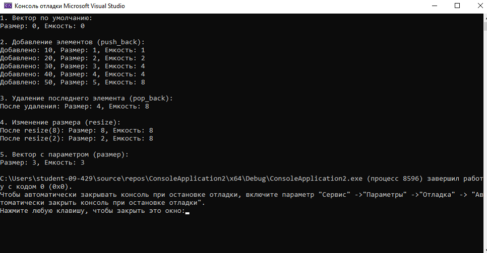

# Отчет к лабораторной работе № 3
# Тема: Реализация динамического массива (аналог vector). Итераторы
# Дисциплина: Алгоритмы и структуры данных
## Выполнил: Бойко Андрей Сергеевич ПИЖ-б-о-25-2
# Цель:
1. Реализовать шаблонный класс Vector - аналог std::vector - с нуля 2. Освоить управление динамической памятью: выделение, расширение, освобождение 3. Закрепить «правило трёх» (деструктор, конструктор копирования, оператор присваивания) и освоить «правило пяти» (конструктор и оператор перемещения) 4. Реализовать итераторы для поддержки range-based for и STLсовместимости 5. Провести амортизированный анализ операции push_back
# Ход работы

Рисунок 1 - работа программы
# Вывод:
: 1. Реализовали шаблонный класс Vector - аналог std::vector - с нуля 2. Освоили управление динамической памятью: выделение, расширение, освобождение 3. Закрепили «правило трёх» (деструктор, конструктор копирования, оператор присваивания) и освоить «правило пяти» (конструктор и оператор перемещения) 4. Реализовали итераторы для поддержки range-based for и STLсовместимости 5. Провели амортизированный анализ операции push_back
# Ответы на контрольные вопросы:
1. Композиция - отношение «часть-целое», при котором часть не может существовать отдельно от целого и полностью управляется им. Пример: Car владеет Engine - двигатель создаётся и уничтожается вместе с машиной.
2. Агрегация - тоже «часть-целое», но часть существует независимо от целого, и целое лишь ссылается на неё. Отличие в том, что при композиции целое владеет частью и управляет её временем жизни, а при агрегации - нет.
3. В C++ композицию реализуют либо полем по значению, либо через std::unique_ptr, чтобы часть автоматически создавалась и уничтожалась вместе с целым.
4. Агрегацию реализуют через указатель или ссылку на объект, который создаётся и удаляется вне класса-владельца, а класс лишь хранит эти ссылки.
5. При композиции время жизни части ограничено временем жизни целого, а при агрегации часть может жить дольше целого и принадлежать нескольким объектам.
6. Статическое поле принадлежит всему классу, а не конкретному объекту, и существует в единственном экземпляре независимо от числа созданных объектов.
7. Объявляется внутри класса со словом static, а определяется обязательно вне класса в .cpp-файле; хранится в статической области памяти программы.
8. Статический метод принадлежит классу и вызывается без объекта, но из него нельзя обращаться к нестатическим полям, так как у него нет привязки к конкретному экземпляру.
9. Статические счётчики объектов используют для подсчёта созданных экземпляров класса, контроля утечек и сбора статистики.
10. Singleton - паттерн, гарантирующий существование класса в единственном экземпляре и предоставляющий глобальную точку доступа к нему.
11. Чтобы запретить копирование, конструктор копирования и оператор присваивания помечают как = delete (или объявляют приватными).
12. При композиции сначала вызываются конструкторы частей, затем конструктор целого; деструкторы - в обратном порядке: сначала целого, затем частей.
13. Да, из обычного метода можно изменить статическое поле, поскольку оно доступно всем методам класса.
14. Статические поля нужно определять вне класса, потому что объявление внутри класса лишь описывает поле, а память под него выделяется именно в определении.
15. Композицию применяют, когда часть не имеет смысла без целого, а агрегацию - когда часть независима и может использоваться несколькими объектами.
